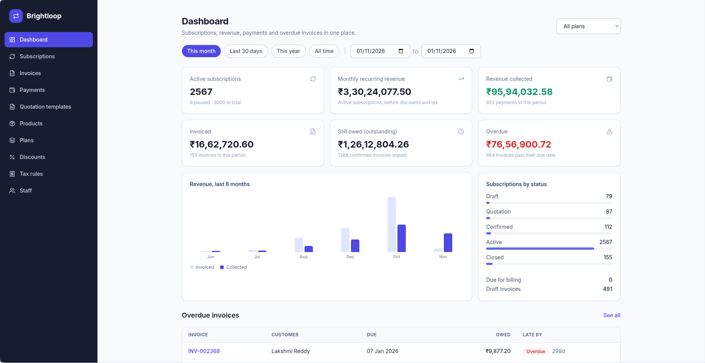
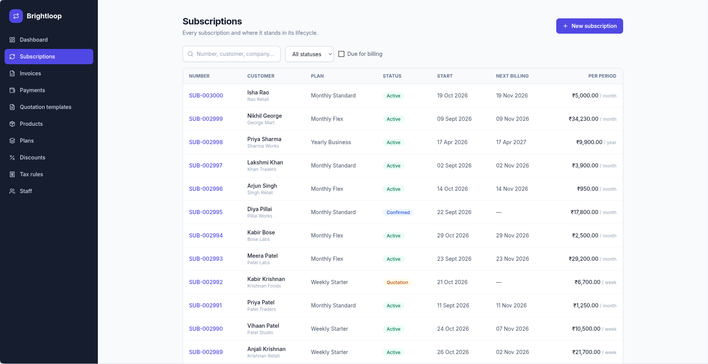
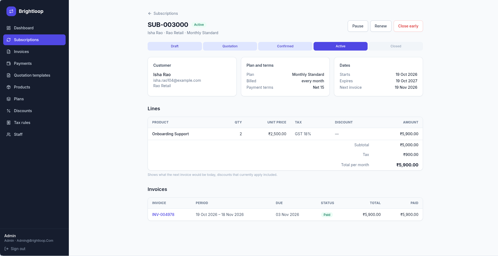
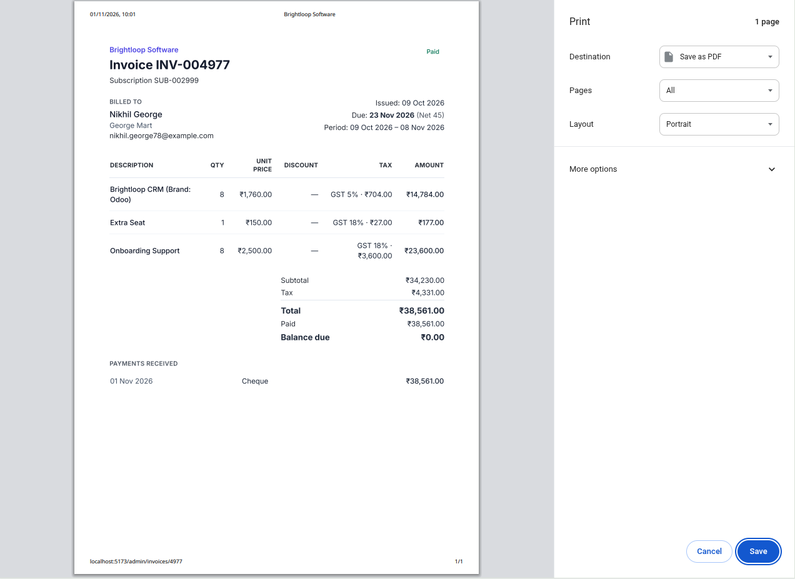

# Modus

A subscription billing system for businesses that sell on a recurring basis. It covers the full cycle: products and plans, quotations, subscriptions, invoices, payments, and the revenue reporting that sits on top of them. Admins, staff and customers each get their own interface.

The project follows the case study of a fictional company, Brightloop Software, which sells software by the month and year. That is why the interface carries the Brightloop name.

## Demo

A walkthrough of all four flows in about 2 minutes 45 seconds: admin, staff, existing customer, and new customer sign-up. Each step is captioned.

https://github.com/user-attachments/assets/132a94df-64c7-4984-986d-6130bc9ad4ed

Also on YouTube: https://youtu.be/ttPO3PHyzKI

## Contents

- [Demo](#demo)
- [The problem](#the-problem)
- [What it does](#what-it-does)
- [Screenshots](#screenshots)
- [How billing works](#how-billing-works)
- [Tech stack](#tech-stack)
- [Running it locally](#running-it-locally)
- [Roles](#roles)
- [Configuration](#configuration)
- [Project structure](#project-structure)
- [API](#api)
- [Tests](#tests)
- [Known limitations](#known-limitations)
- [Team and license](#team-and-license)

## The problem

In the brief, Brightloop tracks customer subscriptions in a spreadsheet, remembers renewals by chance, types invoices by hand every month and matches payments to invoices by scrolling through bank statements. Nobody can say how much recurring revenue the company has at any moment.

Modus replaces that with one system where a subscription is created once and the invoices, totals, payment status and reports follow from it.

## What it does

**Admin**

- Products with variants. A variant such as `Brand: Odoo` adds a fixed amount to the base price.
- Plans with a price, a billing period (daily, weekly, monthly or yearly), a minimum quantity, availability dates, and per-plan rules for auto-close, early close, pause and renewal.
- Tax rules and discount rules. Discounts can be a percentage or a fixed amount, with a minimum purchase or quantity, a validity window and a usage limit.
- Staff accounts. Only an admin can create them.
- A finance dashboard with date and plan filters.

**Staff**

- Quotation templates that hold a plan and a set of product lines, so a quote doesn't start from scratch.
- Subscriptions moving through `Draft → Quotation → Confirmed → Active → Closed`, with pause, renew and close-early actions where the plan allows them.
- Invoices created from subscriptions, reviewed, confirmed and printed.
- Payments recorded against invoices, and a screen for overdue ones.

**Customers**

- Sign up with an email and password, and reset the password by email link.
- A separate portal that shows only their own subscriptions and invoices.

Passwords must be longer than eight characters and contain an uppercase letter, a lowercase letter and a special character. Each email can belong to one account.

## Screenshots

### Finance dashboard

Shown on the demo data set of about 3,000 subscriptions. Active subscriptions, monthly recurring revenue, revenue collected, amount invoiced, amount still owed and overdue invoices, filterable by date range and plan.



### Subscriptions

Search by number, customer or company, filter by status, or show only subscriptions that are due for billing.



### Subscription detail

The lifecycle stage, customer, plan and dates, the product lines with tax and discount, and every invoice raised for the subscription.



### Invoice

Each invoice has a print view that can be saved as a PDF from the browser's print dialog. It shows the lines, tax, total, payments received and balance due.



## How billing works

1. **Lifecycle.** A subscription starts as a draft, becomes a quotation when it is sent, is confirmed by the customer, goes active, and is closed when it ends or is cancelled. Its current stage is visible on every screen that lists it.
2. **Line pricing.** Each line is quantity times unit price. A discount is deducted when it qualifies, meaning it is active, inside its dates, under its usage limit and above its minimums. The line's tax rule is then applied. Products with a variant use the base price plus the variant's extra amount.
3. **Invoicing.** Active subscriptions carry a next billing date. A scheduled job runs daily at 00:05 and handles billing for subscriptions that are due. The subscription page lists every invoice raised for it.
4. **Invoice states.** An invoice moves from Draft to Confirmed to Paid. A confirmed invoice that is unpaid counts as outstanding, and once it passes its due date it also counts as overdue.
5. **Payments.** A payment is recorded against one invoice with its method, amount, date and a note. The invoice shows what has been paid and the balance still due.

## Tech stack

- **Backend:** Python, FastAPI, async SQLAlchemy, Pydantic
- **Database:** SQLite by default. PostgreSQL works by changing `DATABASE_URL`.
- **Auth:** JWT access and refresh tokens, bcrypt password hashing, role checks on every write endpoint
- **Scheduling:** APScheduler
- **Email:** Resend
- **Frontend:** React 18, Vite, Tailwind CSS, React Router, lucide-react icons

## Running it locally

You need Python 3.10 or newer and Node.js 18 or newer.

### Backend

```bash
cd backend
python3 -m venv .venv
source .venv/bin/activate          # Windows: .venv\Scripts\activate
pip install -r requirements.txt
cp .env.example .env
uvicorn app.main:app --reload
```

The API runs at http://localhost:8000. Interactive API docs are at http://localhost:8000/docs.

On startup the app creates any missing tables and an admin account if none exists.

### Frontend

In a second terminal:

```bash
cd frontend
cp .env.example .env
npm install
npm run dev
```

Open http://localhost:5173. The backend has to be running.

### Demo data

An empty database shows empty screens. With the backend started once, run this in `backend/`:

```bash
python -m app.seed_demo              # about 3,000 subscriptions
python -m app.seed_demo --subs 200   # a smaller set
```

It creates customers, products, plans, taxes, discounts, subscriptions, invoices and payments, enough to fill every screen in the screenshots above. It stops if the demo data is already there.

### Logins

| Role | Email | Password |
|---|---|---|
| Admin | `admin@brightloop.com` | `Admin@12345` |
| Staff | `staff@brightloop.com` | `Staff@12345` |
| Customer | `customer@brightloop.com` | `Customer@12345` |

The demo script creates about 120 more customers with the same password. These credentials are for local development only. Change `ADMIN_PASSWORD` and `SECRET_KEY` before running this anywhere public.

## Roles

| Role | What they can do |
|---|---|
| Admin | Everything: products, plans, tax rules, discounts, staff accounts, the dashboard, and all the staff screens |
| Staff | Quotation templates, subscriptions, invoices, payments and overdue follow-up. No access to the product, plan, tax, discount or staff-account screens |
| Customer | The customer portal, limited to their own records |

Routes are guarded in the frontend, and the backend checks the caller's role on each endpoint, so hiding a menu item is not what keeps the data safe.

## Configuration

Backend settings go in `backend/.env`. Copy `backend/.env.example` to start.

| Variable | Purpose |
|---|---|
| `DATABASE_URL` | Defaults to a local SQLite file. A `postgresql://` URL also works. |
| `SECRET_KEY` | Signs the JWTs. Use a long random value, for example `openssl rand -hex 32`. |
| `FRONTEND_URL` | The allowed CORS origin, and the base of password-reset links. Defaults to `http://localhost:5173`. |
| `ADMIN_EMAIL`, `ADMIN_PASSWORD` | The first admin account, created at startup if no admin exists. |
| `RESEND_API_KEY`, `EMAIL_FROM` | Email delivery for password resets. With no key set, the email is printed in the backend console instead of being sent. |

The frontend reads one variable, `VITE_API_URL`, which defaults to `http://localhost:8000`.

## Project structure

```
backend/
  app/
    main.py          app setup, CORS, router registration
    config.py        settings
    database.py      async engine and sessions
    security.py      password hashing and JWTs
    deps.py          auth dependencies and role guards
    scheduler.py     the daily billing job
    seed.py          creates the first admin
    seed_demo.py     demo data generator
    models/          user, product, plan, tax, discount, quotation,
                     subscription, invoice, payment
    schemas/         request and response models
    routers/         one module per resource
    services/        billing, pricing, subscriptions, email
  tests/             end-to-end test of the billing flow
frontend/
  src/
    App.jsx          routes
    api/             API client
    lib/             auth and formatting helpers
    components/      layouts (admin, staff, portal), shared UI
    pages/
      auth/          login, register, forgot and reset password
      admin/         products, plans, taxes, discounts, templates, staff
      shared/        dashboard, subscriptions, invoices, payments
      portal/        customer portal
```

## API

Every route lives under one of these prefixes. The full list, with request and response shapes, is in the generated docs at `/docs`.

| Prefix | Covers |
|---|---|
| `/auth` | Register, login, token refresh, password reset |
| `/users` | Staff and user management |
| `/products` | Products and variants |
| `/plans` | Plans |
| `/taxes` | Tax rules |
| `/discounts` | Discount rules |
| `/quotation-templates` | Quotation templates |
| `/subscriptions` | Subscriptions and their lifecycle |
| `/invoices` | Invoices |
| `/payments` | Payments |
| `/dashboard` | Figures for the finance dashboard |
| `/portal` | Customer-facing endpoints |

## Tests

`backend/tests/test_flow.py` exercises the main flow end to end against a throwaway SQLite database, plus the password-reset flow.

```bash
cd backend
pip install pytest pytest-asyncio
python -m pytest -q
```

## Known limitations

- Payments are recorded by hand. There is no payment gateway.
- Tables are created at startup and there is no migration tool. After changing a model, recreate the database, or add Alembic before using this with real data.
- Emails only go out when a Resend key is configured.
- The demo logins and the default admin password are public in this repository. They exist for local development.

## Team and license

Built by [@sooryathejas](https://github.com/sooryathejas) and [@nivedita-anil](https://github.com/nivedita-anil).

Released under the MIT license. See [LICENSE](LICENSE).
